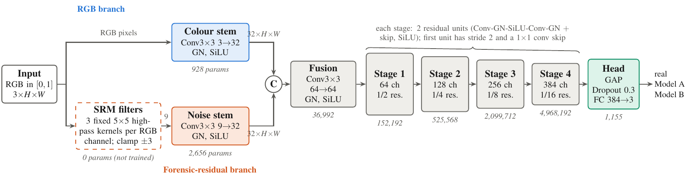

# DSR-Net: AI-generated image detection and source attribution (CE7454 Project 1)

**Ahire Vrushank Ajay**, College of Computing and Data Science, Nanyang Technological University, Singapore.
CE7454 Deep Learning for Data Science, Project 1.

DSR-Net (`DualStreamForensicNet` in the code) is a 7,787,395-parameter dual-stream CNN, trained from scratch, that classifies an image as **real**, **Model A** or **Model B**.

- **RGB branch:** conv 3×3 stem on the pixels.
- **Forensic-residual branch:** fixed SRM-style high-pass filters followed by a conv stem.
- **Fusion and trunk:** early fusion at full resolution, then four residual stages (64/128/256/384 channels).
- **Head:** global average pooling, dropout 0.3, and a linear classifier.

Training uses JPEG re-encoding augmentation (p=0.8, q∈[75,98]) and random 256×256 crops aligned to the 8×8 JPEG grid.



## Results (single model, no TTA or ensembles)

| split | n | accuracy | predicted real / A / B |
|---|---:|---:|---|
| internal val (5% of train, JPEG q91) | 750 | 0.991 | 220 / 256 / 274 |
| dev (CodaBench) | 900 | 0.979 | 258 / 342 / 300 |
| **test (CodaBench)** | 1,500 | **0.484** | 1,011 / 468 / 21 |

The model does not generalise to the hidden test set. It predicts Model B for only 21 test images. Section 5 of the report separates what the prediction files establish from the hypotheses (processing shift, format shortcut) and lists rule-compliant fixes.

## Repository layout
```
code/aigi_jpeg.py             model, training and inference (the submitted run)
data/aigi_jpeg.o25851016      PBS job log of the submitted run
data/*_predictions.json       submitted dev / test predictions
data/summary.json             numbers recomputed from the log and predictions
report/                       4-page CVPR-format report (LaTeX, bib, compiled PDF)
figures/                      report figures (PDF, vector)
figures/src/*.tex             editable TikZ sources for the architecture and dataset figures
scripts/make_plots.py         regenerates curves.pdf and distributions.pdf
archive/                      earlier unsubmitted variant (no reported results)
```

## Reproduce
```bash
pip install -r requirements.txt
# set ROOT (dataset with train/ dev/ test/) and OUT_DIR at the top of code/aigi_jpeg.py
python code/aigi_jpeg.py                  # train (~20 min on one A100) + write dev/test predictions
PREDICT_ONLY=1 python code/aigi_jpeg.py   # predictions only, from OUT_DIR/best.pt
python scripts/make_plots.py              # report plots from data/
```
Training labels are parsed from file names of the form `<id>_<label>.jpg`. The course dataset and model weights are not included in this repository.

## Challenge-rule compliance
- Trained from scratch, with no pretrained weights.
- 7,787,395 trainable parameters, under the 12.3M limit (asserted in code).
- Only the supplied training data is used.
- A single model, with no ensembles, test-time augmentation or distillation.
